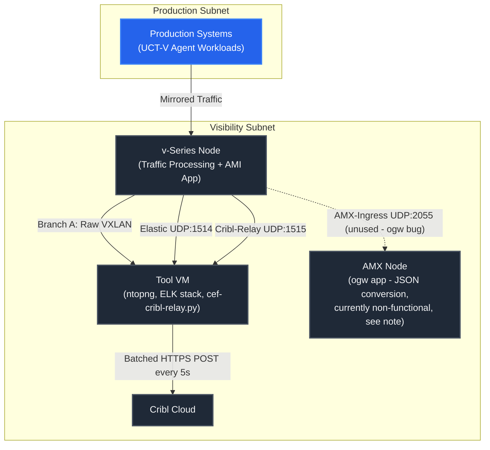

# Azure Lab: Gigamon V Series Cloud Tap Deployment v1.0

This repository contains Terraform Infrastructure-as-Code (IaC) and Python automation to deploy a complete Gigamon V Series traffic visibility lab in Microsoft Azure.

## TL;DR / Quick Start

The deployment wrapper scripts (`runme.sh`, `runme.bat`, `runme.ps1`) handle environment setup, dependency installation, Terraform execution, and will output the total elapsed deployment time upon completion.

### Mac / Linux
```bash
bash runme.sh
```

### Windows
```powershell
.\runme.ps1
```

## Prerequisites & Marketplace Terms
Ensure you have Terraform >= 1.5.0, Azure CLI, and Python 3 installed.

> [!IMPORTANT]
> **UCT-V Agent Package Requirement**  
> Prior to running the deployment script, you **must** place the UCT-V agent Debian package (e.g., `gigamon-gigavue-uctv-6.xx.00-amd64.deb` matching your configured `gigamon_version` in `variables.tf`) in the `UCTV-files` directory. The deployment script performs a pre-flight check to verify this file exists and will halt with an error if it is missing.

The Gigamon Cloud Suite version is controlled by the `gigamon_version` variable in `variables.tf` — it **defaults to `6.14`**; set it to `6.13` to pin the previous release. Both are published to the Azure Marketplace under the same offer. `ami-lab-deploy.py` also auto-detects the version from whichever single `.deb` package is present in `UCTV-files/` and updates this default to match, so it's normal for it to differ from whatever was last committed.

You **must** accept the Azure Marketplace terms for the Gigamon images before deploying, using the plan names for whichever `gigamon_version` you've configured (`v61400` for 6.14, `v61300` for 6.13):

```bash
# Default (6.14)
az vm image terms accept --publisher gigamon-inc --offer gigamon-gigavue-cloud-suite-v2 --plan gfm-azure-v61400
az vm image terms accept --publisher gigamon-inc --offer gigamon-gigavue-cloud-suite-v2 --plan uctv-cntlr-v61400
az vm image terms accept --publisher gigamon-inc --offer gigamon-gigavue-cloud-suite-v2 --plan vseries-node-v61400

# If setting gigamon_version = "6.13" instead
az vm image terms accept --publisher gigamon-inc --offer gigamon-gigavue-cloud-suite-v2 --plan gfm-azure-v61300
az vm image terms accept --publisher gigamon-inc --offer gigamon-gigavue-cloud-suite-v2 --plan uctv-cntlr-v61300
az vm image terms accept --publisher gigamon-inc --offer gigamon-gigavue-cloud-suite-v2 --plan vseries-node-v61300
```

## Architecture Overview



- **Networking**: Single VNet with two subnets (Visibility and Production).
- **Gigamon Fabric**: GigaVUE-FM (Management), UCT-V Controller (Tap Management), vSeries & AMX Nodes (Traffic Processing).
- **Workloads**: 
  - **Tool VM**: Sink for mirrored traffic, ntopng, ELK stack (Elasticsearch, Logstash, Kibana) for AMI records, and `cef-cribl-relay.py` (see [CEF → Cribl Relay](#cef--cribl-relay) below) (Visibility Subnet).
  - **Production VMs**: Ubuntu workloads for traffic generation (Production Subnet).

## Post-Deployment Configuration

`scripts/configure_lab.py` automatically changes GigaVUE-FM's default password (`admin` / `admin123A!!`) to `fm_new_admin_password`, creates an API token via FM's REST API, and uploads it to Key Vault — no manual GUI login required. Just run it (or let `runme.ps1`/`runme.sh`/`runme.bat` continue on into it) and it handles the rest.

If the automated attempt fails for any reason (e.g. an unexpected FM API version), it falls back to the old manual flow and prompts you:

1. **Access GigaVUE-FM**: Open `https://<fm_public_ip>` (IP found via `terraform output`).
2. **Login & Change Password**: Use `admin` / `admin123A!!`. Uncheck SSH Key-Based Auth.
3. **Generate Token**: Navigate to **Administration → User Management → Tokens → Current User Tokens**. Create a new token (105 days, Super Admin Group) and **copy it**.
4. **Paste the token** when the script prompts for it, or upload it to Key Vault yourself:

### Bash / Linux
```bash
KV_NAME="$(terraform output -raw key_vault_name)"
SECRET_NAME="$(terraform output -raw fm_token_secret_name)"
az keyvault secret set --vault-name "$KV_NAME" --name "$SECRET_NAME" --value "<PASTE_FM_TOKEN_HERE>"
```

### PowerShell / Windows
```powershell
$KV_NAME = terraform output -raw key_vault_name
$SECRET_NAME = terraform output -raw fm_token_secret_name
az keyvault secret set --vault-name $KV_NAME --name $SECRET_NAME --value "<PASTE_FM_TOKEN_HERE>"
```
*Note: Agents automatically fetch this token from the Key Vault via managed identity to self-register. They will continually retry every 60 seconds until a valid token is found.*

## Monitoring Session (Automated)

> [!NOTE]
> **Cribl egress is currently disabled** (`enable_cribl = false`, the default). With it off, the lab skips the CEF→Cribl relay on the Tool VM, the AMI app's `Cribl-Relay` and `AMX-Ingress` exports, and the AMX `ogw` session. The AMI app still exports to Elastic on the Tool VM. The sections below that describe Cribl, the AMX session and the relay apply only when you set `enable_cribl = true` together with `cribl_endpoint` and `cribl_auth_token`.


`scripts/configure_lab.py` fully automates both Monitoring Sessions — no manual steps in the FM UI are required. It's idempotent throughout: re-running it detects whatever already exists (domain, session, map, tunnel, app, link) and only creates/deploys what's missing, so it's always safe to run again.

It's also self-healing across a fresh deploy: FM rejects a session deploy or link change until the corresponding vSeries/AMX node has finished registering, which lags a few minutes behind the SSH-based node registration. Rather than requiring a second manual invocation, the script waits for each node to appear registered and then retries the session build/deploy until it succeeds (bounded timeout, ~5 minutes).

### Main session — `Azure-Lab-Session` (vSeries node, domain `Azure-3PO-MD`)

1. Creates the Monitoring Domain and AnyCloud Connection.
2. Creates the session and a traffic map with a pass-all-IPv4 rule.
3. **Branch A — raw packet mirror**: creates a VXLAN tunnel to the Tool VM's private IP, port `4789`, VNI `123` *(the Tool VM's automated configuration expects VNI `123` — do not change without updating both sides)*, and links the map to it. Feeds ntopng / raw `tcpdump` on the Tool VM.
4. **Branch B — metadata pipeline**: adds the AMI ("Application Metadata Intelligence" / `appmetadata`) GigaSMART app to the map, using the `SplunkMetadataTemplate` export profile (CEF-formatted, per-protocol field extraction for krb5/ssh/ssl/ftp/smb/smtp/dhcp/dns/telnet/rdp/http). The AMI app exports to three UDP destinations:
   - **Elastic**: the Tool VM's Logstash listener, port `1514` (already provisioned with a CEF codec writing into the `gigamon-ami-*` Elasticsearch index — see [Verify AMI](#4-verify-application-metadata-intelligence-ami) below).
   - **AMX-Ingress**: the AMX node's ingress data interface (`eth1`). Wired up, but currently a dead end — see the AMX session note below.
   - **Cribl-Relay**: the Tool VM's `cef-cribl-relay.py` listener, port `1515` — the actual path CEF records take to Cribl. See [CEF → Cribl Relay](#cef--cribl-relay) below.
5. Deploys the session.

### AMX session — `Azure-AMX-Session` (AMX node, domain `Azure-3PO-AMX`)

1. Creates the Monitoring Domain and AnyCloud Connection, with `tappingMethod` explicitly set to `none` (Customer Orchestrated Source) — required because this session's traffic arrives via the AMX-Ingress tunnel above, not an automatic tap mechanism. FM defaults new connections to `uctv` if this isn't set explicitly, which silently breaks everything built on top of it.
2. Creates the session, `Ingress-Raw-Endpoint` and `Egress-Raw-Endpoint` entities.
3. Creates the `ogw` GigaSMART app (alias `AMI-AMX`), configured with a `cloudUpload` exporter pointed at the Cribl endpoint (JSON format, `Authorization` header) — this is the CEF→JSON conversion step, captured verbatim from an FM UI HAR export (see `create_ogw_application()` in `configure_lab.py`). No traffic map is used in this topology; it's `Ingress-Raw → ogw app → Egress-Raw` directly.
4. Binds the raw endpoints to the AMX node's two data interfaces (`eth1`/`eth2`) via `endpointIfaceMappings`.
5. Deploys the session.

**Status: configured, but not functional — known Gigamon-side bug.** The session builds cleanly and reports healthy in FM, and CEF metadata visibly arrives at the AMX node's ingress interface (confirmed via FM's dataplane traffic stats). However, it never reaches the `ogw` app's own `ogw_ingestor` process — its internal Redis-backed packet counters stay at zero indefinitely, while the raw ingress `rep` interface's counters keep climbing. Verified this isn't a config or connectivity issue: the ingestor's listening socket works fine when sent test packets directly (both IPv4 and IPv6 loopback), and the node can reach Cribl over the network without trouble. The gap is specifically in the node's internal DPDK-dataplane-to-Linux-app handoff — invisible and uncontrollable from the FM API. Getting the `ogw` app to `lnx_apps` mode cleanly (rather than conflicting with the `gs_apps` mode used by a plain traffic map) also required a full AMX VM redeploy plus deleting and rebuilding the session from scratch — a stale `gs_apps` marker otherwise sticks to the *session*, not just the node, and survives a VM replace. If you want to pursue this further, `configure_ami_monitoring_session_flow()` and `create_ogw_application()` are unmodified and idempotent — re-running `configure_lab.py` after any Gigamon-side fix should just work. In the meantime, **[CEF → Cribl Relay](#cef--cribl-relay)** below is what actually delivers data.

If you need to build the session manually instead (e.g. for a custom traffic rule), use **Traffic** > **Virtual** > **Orchestrated Flows** > **Azure** in the FM UI and mirror the steps above.

## CEF → Cribl Relay

Since the AMX/`ogw` pipeline above doesn't currently work, `configure_lab.py` deploys a small, fully self-contained relay to the Tool VM instead — `deploy_cribl_relay()` pushes it over SSH as a systemd service (`cef-cribl-relay.service`, `/opt/cef-cribl-relay.py`), no dependency on Gigamon's app internals:

1. Listens on UDP `:1515` for CEF records (the AMI app's `Cribl-Relay` export destination, above).
2. Buffers incoming records in memory; every 5 seconds, flushes whatever's buffered as a single HTTPS POST to the Cribl endpoint, with the `Authorization` header set from `cribl_auth_token`.
3. Logs every send (record count, byte size, HTTP status) to `/var/log/cef-cribl-relay.log` on the Tool VM.

Raw CEF text is sent as-is — no JSON conversion — and Cribl's own pipeline handles parsing on receipt. `Restart=always` in the unit file keeps it running across crashes/reboots.

```bash
ssh -i ./lab_key.pem peter@<tool_vm_public_ip> "sudo tail -f /var/log/cef-cribl-relay.log"
```

## Usage & Verification

### 1. SSH Access
Retrieve ready-to-use SSH commands from Terraform:

#### Bash / Linux
```bash
terraform output | grep ssh_
```

#### PowerShell / Windows
```powershell
terraform output | Select-String "ssh_"
```
*(Example: `ssh -i ./lab_key.pem peter@<ip>`)*


### 2. Generate Traffic
You can generate test traffic using the provided web traffic simulation script or manually via `iperf3`.

**Option A: Web Traffic Simulation**
A script is provided to simulate staggered DNS and HTTP/HTTPS requests to over 500 websites.
This script is automatically deployed to the production VMs during provisioning.
1. SSH into one of the Production VMs.
2. Run the script: `/usr/local/bin/generate_web_traffic.sh`

**Option B: iPerf3**
Run `iperf3` between the two production VMs to generate inspectable traffic:
- **On Prod VM 2 (Server):** `iperf3 -s`
- **On Prod VM 1 (Client):** `iperf3 -c <prod2_private_ip> -t 300`

**Option C: UDP Barrage (Python)**
A Python script is provided to generate a high volume of UDP messages to the netcat listener.
- **On Prod VM 2 (Server):** Run `/usr/local/bin/start_nc_listener.sh`
- **On Prod VM 1 (Client):** Run `udp_barrage.py <prod2_private_ip> --count 5000`

### 3. Verify Visibility
- **ntopng**: Access `http://<tool_vm_public_ip>:3000` (admin/admin), select the `vxlan0` interface to see real-time mirrored traffic.
- **Raw Packet Dump**: Run `sudo tcpdump -i vxlan0 -n` on the Tool VM.

### 4. Verify Application Metadata Intelligence (AMI)
- **Kibana**: Access `http://<tool_vm_public_ip>:5601`.
- Create a Data View in Kibana matching `gigamon-ami-*` to visualize the parsed metadata records.
- This is fully automated (see [Monitoring Session (Automated)](#monitoring-session-automated) above) — no manual FM configuration needed. Traffic should already be flowing once `configure_lab.py` completes.

---

---

## Troubleshooting

**Configuration Script Fails (SSH Delay):**
If the final step of the deployment script (`configure_lab.py`) fails due to an SSH timeout (VMs are fully provisioned but SSH daemons are not yet responsive), the underlying infrastructure was still successfully deployed. You can safely retry the post-deployment SSH configuration at any time by running:
`python scripts/configure_lab.py`

**vSeries/AMX Node Landed on Unsupported Hardware (MANA):**
Gigamon's DPDK build doesn't yet support Azure's newer MANA network adapter. If a vSeries or AMX node's data interface fails to bind (`dpdk-devbind.py --status` shows it `unused` rather than bound to a kernel driver, and `vseries-node` logs repeat `Error: No devices specified`), the VM landed on MANA-capable hardware. All Gigamon Marketplace VMs in this repo carry the `LegacyVMNVA` tag (Azure's documented NVA opt-out — see [modules/gigamon-vm/main.tf](modules/gigamon-vm/main.tf)), which should prevent this on a fresh deploy. If it still happens, force a re-placement:
```bash
az vm deallocate --resource-group <rg_name> --name <vm_name>
az vm start --resource-group <rg_name> --name <vm_name>
```
A `reapply` alone is not sufficient — it only re-asserts the tag on the VM's *current* allocation, it doesn't trigger a fresh hardware placement decision.

**Terraform State Backend Disappeared (`ResourceGroupNotFound` on plan/apply/destroy):**
This subscription runs an automated cleanup that deletes resources tagged with an expired `hours needed` value. The lab's actual VMs are tagged `Hours Needed=Always` (exempt) by the Terraform modules, but the remote-state backend that `ami-lab-deploy.py`'s `bootstrap_remote_state()` creates (`<project>-tfstate-rg` and its storage account) used to be tagged `hours needed=8` — a real, expiring value — so it could get swept while the lab itself kept running untouched. This is fixed (the backend is now tagged `Hours Needed=Always` too), but if you hit this on an older deploy: Terraform can't recover a deleted state backend, but the actual Azure resources are unaffected. Delete them directly instead of via `terraform destroy`:
```bash
az group delete --name <project_name> --yes
```

## Support & Contact
For questions, issues, or contributions regarding this lab configuration, please reach out to:
* **Contact**: [pete.connolly@gigamon.com][def]
