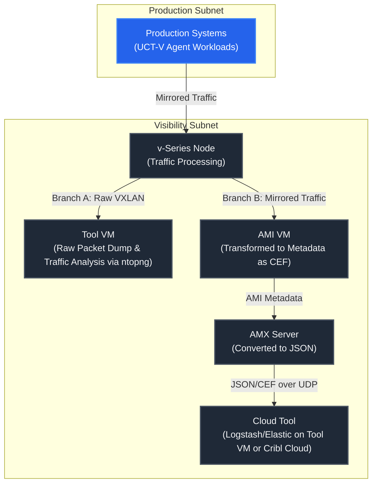

# Azure Lab: Gigamon V Series Cloud Tap Deployment v1.0

This repository contains Terraform Infrastructure-as-Code (IaC) and Python automation to deploy a complete Gigamon V Series traffic visibility lab in Microsoft Azure.

## TL;DR / Quick Start

The deployment wrapper scripts (`runme.sh`, `runme.bat`, `runme.ps1`) handle environment setup, dependency installation, Terraform execution, and will output the total elapsed deployment time upon completion.

### Mac / Linux
```bash
bash runme.sh
```

### Windows
```powershell
.\runme.ps1
```

## Prerequisites & Marketplace Terms
Ensure you have Terraform >= 1.5.0, Azure CLI, and Python 3 installed.

> [!IMPORTANT]
> **UCT-V Agent Package Requirement**  
> Prior to running the deployment script, you **must** place the UCT-V agent Debian package (e.g., `gigamon-gigavue-uctv-6.xx.00-amd64.deb` matching your configured `gigamon_version` in `variables.tf`) in the `UCTV-files` directory. The deployment script performs a pre-flight check to verify this file exists and will halt with an error if it is missing.

You **must** accept the Azure Marketplace terms for the Gigamon images before deploying:


```bash
az vm image terms accept --publisher gigamon-inc --offer gigamon-gigavue-cloud-suite-v2 --plan gfm-azure-v61300
az vm image terms accept --publisher gigamon-inc --offer gigamon-gigavue-cloud-suite-v2 --plan uctv-cntlr-v61300
az vm image terms accept --publisher gigamon-inc --offer gigamon-gigavue-cloud-suite-v2 --plan vseries-node-v61300
```

## Architecture Overview



- **Networking**: Single VNet with two subnets (Visibility and Production).
- **Gigamon Fabric**: GigaVUE-FM (Management), UCT-V Controller (Tap Management), vSeries & AMX Nodes (Traffic Processing).
- **Workloads**: 
  - **Tool VM**: Sink for mirrored traffic, ntopng, and ELK stack (Elasticsearch, Logstash, Kibana) for ingesting Application Metadata Intelligence (AMI) records (Visibility Subnet).
  - **Production VMs**: Ubuntu workloads for traffic generation (Production Subnet).

## Post-Deployment Configuration (CRITICAL)
GigaVUE-FM requires a manual password change and token generation before the fabric can register.

1. **Access GigaVUE-FM**: Open `https://<fm_public_ip>` (IP found via `terraform output`).
2. **Login & Change Password**: Use `admin` / `admin123A!!`. Uncheck SSH Key-Based Auth.
3. **Generate Token**: Navigate to **Administration → User Management → Tokens → Current User Tokens**. Create a new token (105 days, Super Admin Group) and **copy it**.
4. **Upload Token to Key Vault**:

### Bash / Linux
```bash
KV_NAME="$(terraform output -raw key_vault_name)"
SECRET_NAME="$(terraform output -raw fm_token_secret_name)"
az keyvault secret set --vault-name "$KV_NAME" --name "$SECRET_NAME" --value "<PASTE_FM_TOKEN_HERE>"
```

### PowerShell / Windows
```powershell
$KV_NAME = terraform output -raw key_vault_name
$SECRET_NAME = terraform output -raw fm_token_secret_name
az keyvault secret set --vault-name $KV_NAME --name $SECRET_NAME --value "<PASTE_FM_TOKEN_HERE>"
```
*Note: Agents automatically fetch this token from the Key Vault via managed identity to self-register. They will continually retry every 60 seconds until a valid token is found.*

## Monitoring Session (Automated)

`scripts/configure_lab.py` fully automates the Monitoring Session setup — no manual steps in the FM UI are required. When run, it:

1. Creates the Monitoring Domain(s) and AnyCloud Connection(s).
2. Creates the Monitoring Session (`Azure-Lab-Session`).
3. Adds a traffic map with a pass-all-IPv4 rule.
4. Creates a VXLAN tunnel destination pointed at the Tool VM's **private IP** (passed in automatically via Terraform), port `4789`, VNI `123` *(the Tool VM's automated configuration expects VNI `123` — do not change without updating both sides)*.
5. Links the map to the tunnel and deploys the session to the vSeries nodes.

Re-running the script is safe — it detects an already-configured session (existing map/tunnel) and skips recreating it, only (re)deploying if needed.

If you need to build the session manually instead (e.g. for a custom traffic rule), use **Traffic** > **Virtual** > **Orchestrated Flows** > **Azure** in the FM UI and mirror the steps above.

## Usage & Verification

### 1. SSH Access
Retrieve ready-to-use SSH commands from Terraform:

#### Bash / Linux
```bash
terraform output | grep ssh_
```

#### PowerShell / Windows
```powershell
terraform output | Select-String "ssh_"
```
*(Example: `ssh -i ./lab_key.pem peter@<ip>`)*


### 2. Generate Traffic
You can generate test traffic using the provided web traffic simulation script or manually via `iperf3`.

**Option A: Web Traffic Simulation**
A script is provided to simulate staggered DNS and HTTP/HTTPS requests to over 500 websites.
This script is automatically deployed to the production VMs during provisioning.
1. SSH into one of the Production VMs.
2. Run the script: `/usr/local/bin/generate_web_traffic.sh`

**Option B: iPerf3**
Run `iperf3` between the two production VMs to generate inspectable traffic:
- **On Prod VM 2 (Server):** `iperf3 -s`
- **On Prod VM 1 (Client):** `iperf3 -c <prod2_private_ip> -t 300`

**Option C: UDP Barrage (Python)**
A Python script is provided to generate a high volume of UDP messages to the netcat listener.
- **On Prod VM 2 (Server):** Run `/usr/local/bin/start_nc_listener.sh`
- **On Prod VM 1 (Client):** Run `udp_barrage.py <prod2_private_ip> --count 5000`

### 3. Verify Visibility
- **ntopng**: Access `http://<tool_vm_public_ip>:3000` (admin/admin), select the `vxlan0` interface to see real-time mirrored traffic.
- **Raw Packet Dump**: Run `sudo tcpdump -i vxlan0 -n` on the Tool VM.

### 4. Verify Application Metadata Intelligence (AMI)
- **Kibana**: Access `http://<tool_vm_public_ip>:5601`.
- Create a Data View in Kibana matching `gigamon-ami-*` to visualize the parsed metadata records.
- In **GigaVUE-FM**, configure your AMX node to export metadata via **UDP/JSON** to the Tool VM's private IP on port `1514`.

---

---

## Troubleshooting

**Configuration Script Fails (SSH Delay):**
If the final step of the deployment script (`configure_lab.py`) fails due to an SSH timeout (VMs are fully provisioned but SSH daemons are not yet responsive), the underlying infrastructure was still successfully deployed. You can safely retry the post-deployment SSH configuration at any time by running:
`python scripts/configure_lab.py`

## Support & Contact
For questions, issues, or contributions regarding this lab configuration, please reach out to:
* **Contact**: [pete.connolly@gigamon.com][def]
