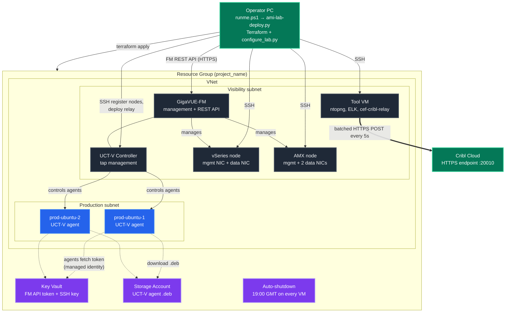
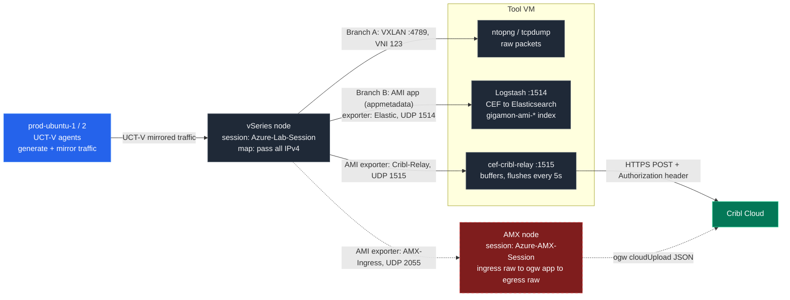
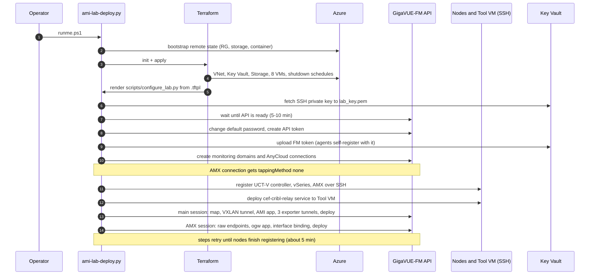

# Azure Lab – What it builds and how it's linked

> Cribl egress (relay, AMX ogw session, `Cribl-Relay` / `AMX-Ingress` exports) is **disabled by default** (`enable_cribl = false`). The diagrams show the full topology; the Cribl and AMX-session parts only run when it is enabled.

Three views: the Azure resources, the traffic/metadata data flow, and the deployment sequence.

## 1. What gets built (Azure resources)

## 2. How traffic and metadata flow

Dashed red = wired up but not currently delivering. The README documents an AMX/ogw ingestor bug, so the relay on the Tool VM is the working path to Cribl. On 6.14 the ogw app also needs the AMX connection set to `tappingMethod: none` and `maxEntries` of at least 5000, both now handled in `configure_lab.py.tftpl`.

## 3. Deployment sequence

